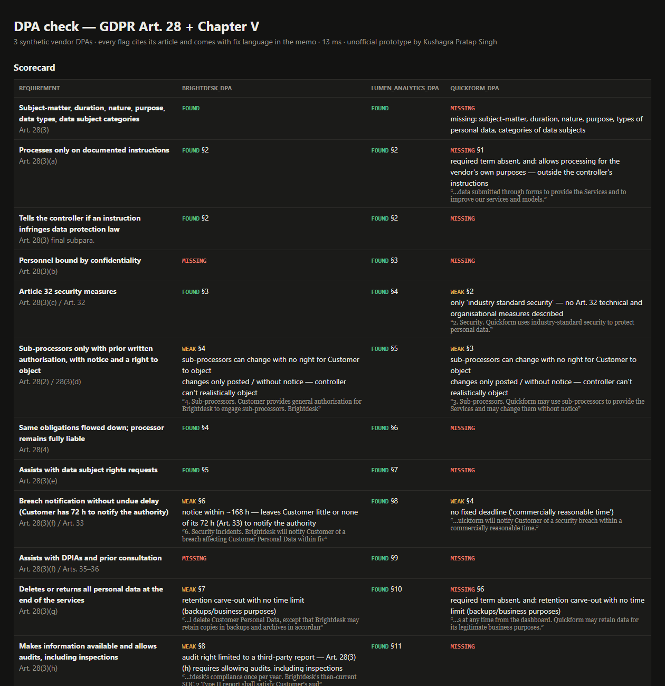

# DPA Check — GDPR Article 28

> Unofficial prototype by Kushagra Pratap Singh. Not affiliated with Moritz.

## The problem

Moritz is an AI-native law firm where "AI does 80% of the work" through custom workflows and playbooks, and attorneys do the final 20%. Turnaround is same day to 24 hours at flat fees, and the privacy practice covers **DPAs, DPIAs and outsourced DPO services** ([moritzlegal.com](http://moritzlegal.com)).

A vendor DPA review is the classic version of that 80/20 split. Every DPA has to contain the terms GDPR **Article 28(3)** makes mandatory, points (a)–(h) plus the processing particulars. Sub-processors need authorisation, notice and a right to object (Art. 28(2)), obligations must flow down (Art. 28(4)), and transfers outside the EEA need a Chapter V basis ([text](https://gdpr-info.eu/art-28-gdpr/)). The judgement is in the weak versions: breach notice "within 5 business days", audits "satisfied by our SOC 2 report", sub-processors "posted on our website", backups kept "in accordance with standard practices".

## What I built

A stdlib Python checker. It maps a DPA clause by clause against a **rule library where every rule cites its article and carries fix language**, and returns FOUND / WEAK / MISSING with the clause number and the quoted text. It then writes a memo the attorney can edit.



```
brightdesk_dpa: 7 found · 4 weak · 2 missing
  MISSING Art. 28(3)(b)          Personnel bound by confidentiality
  WEAK    Art. 28(2) / 28(3)(d)  Sub-processors …  §4 — sub-processors can change with no right for Customer to object
  WEAK    Art. 28(3)(f) / Art. 33 Breach notification … §6 — notice within ~168 h — leaves Customer little or none of its 72 h
  MISSING Art. 28(3)(f) / 35–36  Assists with DPIAs and prior consultation
  WEAK    Art. 28(3)(g)          Deletion …  §7 — retention carve-out with no time limit (backups/business purposes)
  WEAK    Art. 28(3)(h)          Audits …    §8 — audit right limited to a third-party report

checked 3 DPAs in 13 ms
```

An example memo with proposed language for each gap is in [`docs/example_memo.md`](docs/example_memo.md).

| Rule | Article | Typical WEAK signal |
|---|---|---|
| Processing particulars (Annex) | 28(3) | missing subject-matter / duration / nature / purpose / data types / data subjects |
| Documented instructions only | 28(3)(a) | "to improve our services and models" |
| Flag infringing instructions | 28(3) final subpara. | — |
| Personnel confidentiality | 28(3)(b) | — |
| Art. 32 security | 28(3)(c) | only "industry-standard security" |
| Sub-processor authorisation + objection | 28(2), 28(3)(d) | "posted on our website", "without notice", no objection right |
| Flow-down + full liability | 28(4) | — |
| Data subject rights assistance | 28(3)(e) | — |
| Breach notification | 28(3)(f), 33 | "commercially reasonable time", or more than 48 h (business days are converted) |
| DPIA / prior consultation assistance | 28(3)(f), 35–36 | — |
| Delete or return at the end | 28(3)(g) | backups or "legitimate business purposes" retained with no limit |
| Information + audits incl. inspections | 28(3)(h) | SOC 2 / ISO report "in lieu of" audits |
| Transfers | Ch. V (44–46) | US or India storage with no SCCs or adequacy basis |

**About the data and the limits:** the three DPAs (Lumen, Brightdesk, Quickform) are made up and written to cover the common patterns: one clean, one mediocre, one bad. The rules are transparent regexes, so they are easy to audit and easy to extend, but they will miss unusual phrasing. In the 80/20 model the checker is the first pass and the attorney decides. The 48-hour breach threshold is a negotiating position, not a legal requirement.

## Run it (3 commands)

```bash
pip install -r requirements.txt       # only pytest; the checker is stdlib
python demo.py                        # or: python demo.py path/to/dpa.md
python -m pytest -q                   # 11 tests
```

## Next steps (not built)
UK GDPR (IDTA / UK Addendum) and US state-law rule packs, .docx/PDF input, per-client playbooks (e.g. "breach ≤ 24 h"), and an LLM pass that proposes redlines in the client's voice, with the rule hits kept as the auditable source of truth.

---
Unofficial prototype by Kushagra Pratap Singh. Not affiliated with Moritz. Not legal advice.
